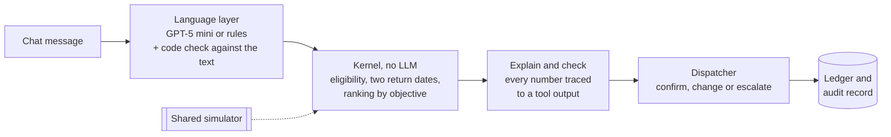

# Subcontracting Desk

**DSS5105 Capstone · Track 2: The Quick-Response Subcontracting Desk · Group 12**

Today, sending a batch to an outside workshop is one unchecked message in a group chat. The desk reads that message, checks in code whether each workshop can make the product, can take it now and is allowed to, recommends one with two return dates and the reason, and records what the dispatcher confirms.

- **Live app:** <https://track2-desk-group12.streamlit.app> (public, no sign-in, works on a phone)
- **Team:** Qu Yanyue, Zhang Jinruo, Wu Jie, Li Yan, Wu Ruohan, Xu Peiyao

## Run it locally

Tested on Python 3.12.

```bash
git clone https://github.com/dss5105-track2/track2-desk.git
```

```bash
cd track2-desk
```

```bash
python -m pip install -r requirements.txt
```

```bash
streamlit run app/streamlit_app.py
```

The browser opens <http://localhost:8501>. Click **Load morning inbox** to receive the 30 chat messages of 1 April, or type a message in the box at the top of **Dispatch**.

No API key is needed: without one the desk uses its rule-based parser and the GPT-5 mini option stays disabled.

### Optional: use GPT-5 mini

Copy `.env.example` to `.env` and set `OPENAI_API_KEY`. `.env` is git-ignored; never commit a key. Reading one message costs about $0.001, and `DESK_LLM_BUDGET_USD` (default 2) is a hard stop per process.

### Check it works

```bash
python -m pytest -q
```

238 tests should pass.

| Command | What it does |
|---|---|
| `python harness/simulate.py` | The shared simulator with its three baselines |
| `python harness/run_baselines.py` | Baselines, the simple rule and our settings; add `--shock` for the closure scenario |
| `python desk/pipeline.py` | Processes the 30 messages in order; `--only R21` shows one decision and its tool calls |
| `python eval/run_language_eval.py --labels eval/gold_labels.csv` | Scores the 30 official messages; `--parser llm --runs 3` uses the model and costs money |

## How it works



- **The model only reads.** Dates, queues and comparisons come from code tools, specified in [`docs/tool_spec.md`](docs/tool_spec.md).
- **Four replies:** dispatch, ask back, refuse with a reason and an alternative, or say the data cannot answer.
- **Nothing is booked until the dispatcher confirms.**
- **One message can carry several orders.** Each order number gets its own card, showing the whole message. If the orders are only listed, a shop or ban in the message applies to all of them; if each is followed by its own words, those stay with it. Anything else is not applied: the order book's values stand and the card says to read the message. Words like "not", "already" or "don't" beside several orders get a question instead. Several batches with no order numbers get a question, not a guess.
- **A workshop can stop.** Report it in chat ("GiantWeave has shut for two weeks") or on the Workshops tab. Once the dispatcher confirms, no new work goes there, open requests are re-ranked, and batches already there can be moved in one click, within what their own request allowed.
- **The objective is a setting.** The interface offers three:

| Setting | Role | How it ranks |
|---|---|---|
| `use_slack` | Primary: fewest late batches | Keep shops on time even if reworked; prefer the specialist; take the latest safe finish so fast shops stay free |
| `defects` | Other objective | Defect rate weighted equally with lateness |
| `hybrid` | Weighted mix | Late 1.0, finish 0.3, defects 0.25, load 0.5, normalised within the candidates |

`lateness`, `fairness`, `cost` and two round-1 settings remain in `kernel/allocator.py` for the simulator and the command line.

## Results

### Allocation: shared simulator

120 official orders, seeds 5105–5114, simulator unchanged. Reproduce with `experiments/scripts/exp_round2.py`; results are in [`experiments/allocator_results/`](experiments/allocator_results/).

| Policy | % late | % late, shock | % defective pieces | Cost | Mean days |
|---|---|---|---|---|---|
| random (baseline) | 34.2 | 38.2 | 5.6 | 111,780 | 21.9 |
| greedy_biggest (baseline) | 84.3 | 84.9 | 5.3 | 108,430 | 50.3 |
| cheapest (baseline) | 91.8 | 91.8 | 8.2 | 85,960 | 106.2 |
| simple rule: earliest finish | 1.67 | 1.92 | 7.2 | 115,567 | 8.3 |
| **use_slack (primary)** | **1.00** | **1.67** | 6.8 | 105,503 | 14.0 |
| defects | 28.67 | 31.00 | 5.1 | 110,396 | 21.1 |
| hybrid | 4.33 | 5.50 | 6.1 | 111,238 | 10.1 |

On 100 perturbed order books not used for tuning, `use_slack` is 0.79% late against 1.68% for the simple rule, better on 79 sets and worse on 2.

**Where a baseline still wins:** `cheapest` costs less; `random` and `greedy_biggest` send fewer defective pieces; the simple rule is about six days faster.

### Language: messages

| Set | Messages | Status | GPT-5 mini, right response type |
|---|---|---|---|
| Official | 30 | Used in development | 100% |
| Challenge | 38 | AI-written, used in development | 100% |
| **Held-out, first run** | 43 | **Clean: answers frozen before the system saw them** | **89.1%** (115/129, 3 runs) |
| Held-out, second run | 43 | **Not clean: fixes followed the first run's errors** | 92.2% (119/129, 3 runs) |

The first-run figure missed our 90% target and is the one to quote. The rule-based parser scored 86.0% on the first run and 88.4% on the second. Li Yan reproduced the first run independently: the rule-based run matched line by line, and GPT-5 mini scored 88.4%, within normal model variation.

Records: [`first_run.md`](eval/heldout/first_run.md), [`second_run.md`](eval/heldout/second_run.md), [`reproduce_liyan/`](eval/heldout/reproduce_liyan/REPRODUCE.md). Known failures: [`experiments/failure_cases.md`](experiments/failure_cases.md).

## Known limitations

- **Closure handling relies on someone reporting it.** The desk has no feed of real queues, so it does not notice a stop by itself. A queue-based detector exists only as a simulator experiment and is not a default: even perfect knowledge of the closure lowers lateness by under 0.1 points. See [`closure_detection.md`](experiments/simulator_assumptions/closure_detection.md).
- **Several tasks in one message are only partly handled.** Splitting uses patterns on order numbers, so unusual wording can still be misread; a person confirms every card. A second batch beside one order, or a question on another topic, is flagged when recognised but not acted on. The evaluation sets contain no message with two order numbers, so this has targeted tests and independent review but no clean score.
- **Stop reports are matched by patterns**, in code and not by the model, so unusual wording is missed. A person confirms every stop, because a pattern cannot tell a real closure from a rumour. Duration ("for two weeks") is not read, and dates already promised at a stopped workshop are not recalculated.
- **Seven-day calendar: working days are not implemented.** Estimates assume a seven-day week, as the simulator does. A Sunday-closed variant exists only as an experiment (`experiments/scripts/exp_sunday.py`): the simple rule rises to 3.67% late.
- **One message, two problems.** Messages that both name an ineligible workshop and repeat a dispatch (H41, H42) get "already sent?" where the labels say refuse. The labelling rules did not set an order, and this is not fixed.
- **Status questions** about a customer with several orders (H03) are declined where the labels say ask back.
- **The ledger lives in memory.** It is lost when the session ends unless `audit.json` is downloaded, and it suits one dispatcher.
- **The decision check under-scores the system.** The frozen answers omit standing exclusions, so honouring one can be marked wrong (H35, H38).

## Repository layout

```
app/           Streamlit dispatcher interface
desk/          The pipeline: parse, check, decide, explain
kernel/        Deterministic core, no LLM: register, orders, estimator, allocator, ledger
llm/           GPT-5 mini client, rule-based parser, check of values against the text
language/      Request schema and hand-made parses of the 30 messages
data/          Official data, unchanged
harness/       Shared simulator (unchanged) and baseline runners
scenarios/     Stress scenarios: tight due dates, accessory surge
eval/          Protocol, labelling guide, labels, scoring scripts, independent decision checker
eval/heldout/  Frozen held-out inbox and the records of each run
experiments/   Scripts and results behind the numbers above, challenge set, failure cases
docs/          Tool specification, architecture, interface guide, user test tasks, factory primer, round-2 history
tests/         238 automated tests
```

Some working documents are in Chinese, including the held-out run records, the interface guide and the evaluation protocol.

## Use of AI

We used AI tools throughout, and report them because they affect how to read the results.

- **Claude (Anthropic)** drafted much of the code, documents and experiments under the team's direction. It also drafted the skeletons for the held-out messages and proposed how to settle labelling disagreements, which the team reviewed and accepted.
- **Team members** wrote and double-labelled the held-out messages, and voted on the labels of the official 30.
- **GPT-5 mini** is part of the product, reading chat messages at run time. Its 38-message challenge set is AI-written, so we do not treat it as a clean test.

Individual contributions are set out in `Teams.pdf` in the final submission.
