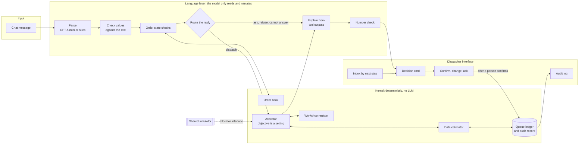

# Architecture

Original design by Xu Peiyao and Wu Jie.

## Kernel entry points

The language layer and the interface call the kernel through these four:

| Entry | Location | Signature |
|---|---|---|
| eligible | `kernel/register.py` | `eligible_workshops(workshops, category, pieces, exclude=()) -> list[Workshop]` |
| estimate | `kernel/estimator.py` | `estimate(w, pieces, queue_days, sent_date, due_date, include_rework=True) -> Estimate` |
| rank | `kernel/allocator.py` | `Allocator(objective).rank(batch, workshops, queues, exclude=(), preference=None) -> list[dict]` |
| commit | `kernel/ledger.py` | `Ledger.commit(request_id=, order_id=, workshop_id=, ..., confirmed_by=) -> dict` |

The simulator sees only `Allocator.__call__(batch, workshops, queues) -> workshop_id`. The language layer takes no part in simulator runs.
